# Class Facility Portal

A campus web app for finding free rooms, viewing class schedules, reserving rooms, and borrowing equipment. It works in English and Indonesian, on phones, tablets, and desktops.

Developed from August to November 2026 as an internal tool for the International Class program at Telkom University, in a private repository. This is a cleaned public version: staff/admin features, real data, and internal configuration have been removed, and sample data is used instead.

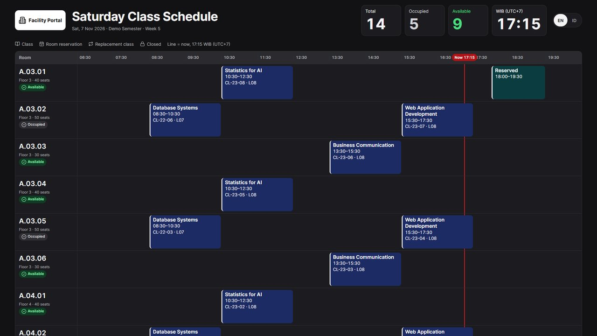

## What it does

| Area | What people can do |
|---|---|
| **Find a room** | Search free rooms by date, time, capacity, and building, and see what blocks a specific room |
| **Requests** | Reserve a room or request a class reschedule, with clash checks and suggested alternatives when a request is rejected |
| **Borrow equipment** | Choose dates and quantities per item. The app picks available units and avoids ones already requested |
| **Building dashboard** | Browse rooms with live status, the class schedule, and a room timeline |
| **Schedule board** | A dark, auto-refreshing screen for building lobbies, with fonts stored locally |

## Screenshots

All screenshots use the sample data from the seeder.

### Find a room

| Free rooms, with the gap before and after each class | What blocks a specific room |
|---|---|
| 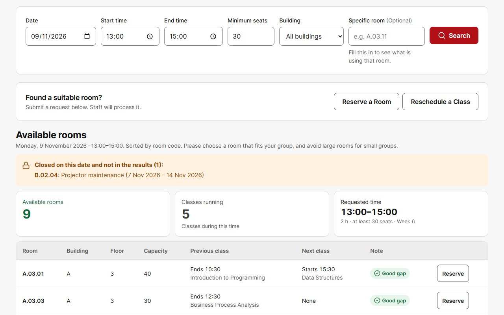 | 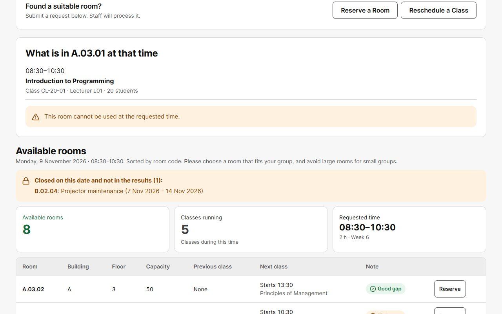 |

### Requests

| Reservation rejected for a clash, with other free rooms suggested | Class reschedule that checks the cancelled session is on the right day |
|---|---|
| 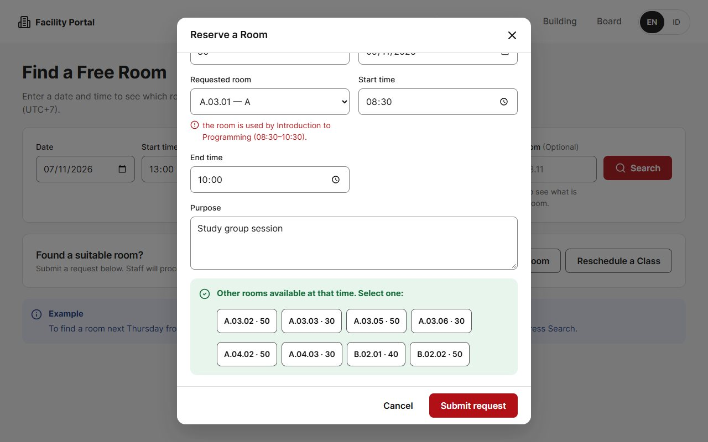 | 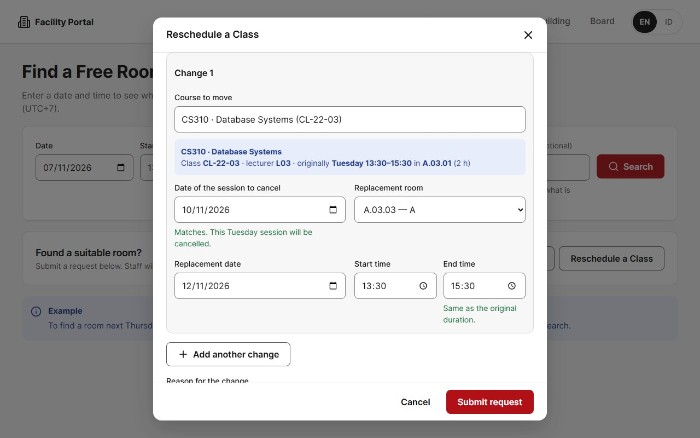 |

### Building dashboard

| Rooms with live status | Class schedule with filters |
|---|---|
| 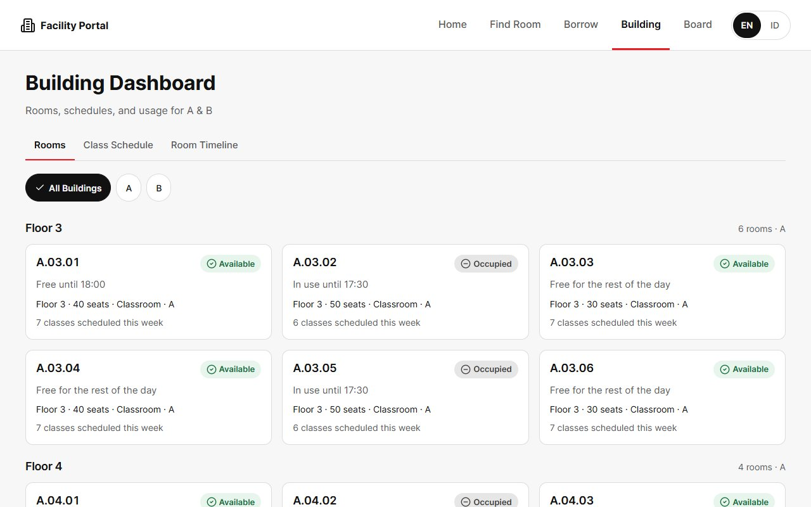 | 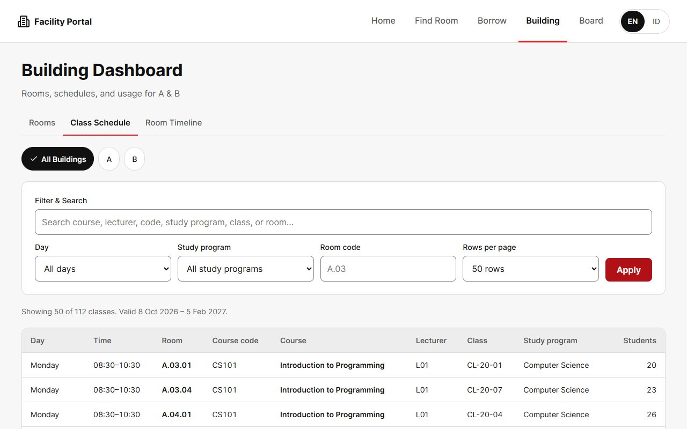 |

Room timeline, with a line marking the current time:

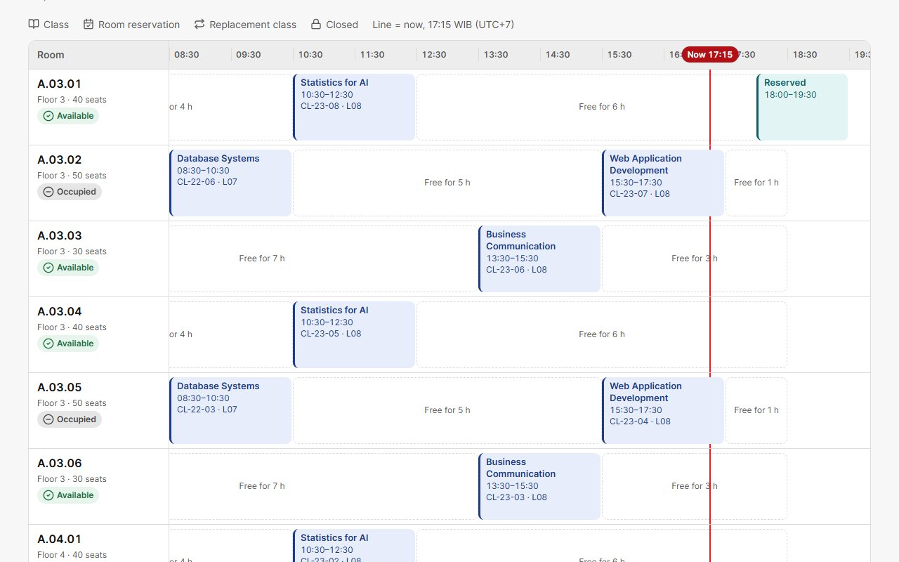

### Borrow equipment and Indonesian interface

| Choose dates and quantities | The same dashboard in Indonesian |
|---|---|
| 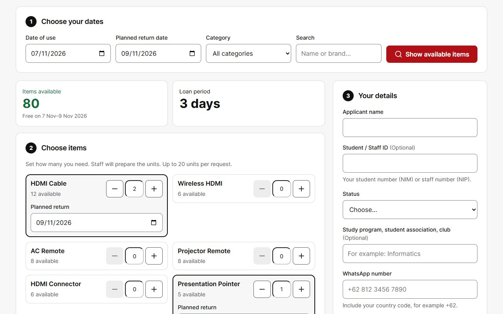 | 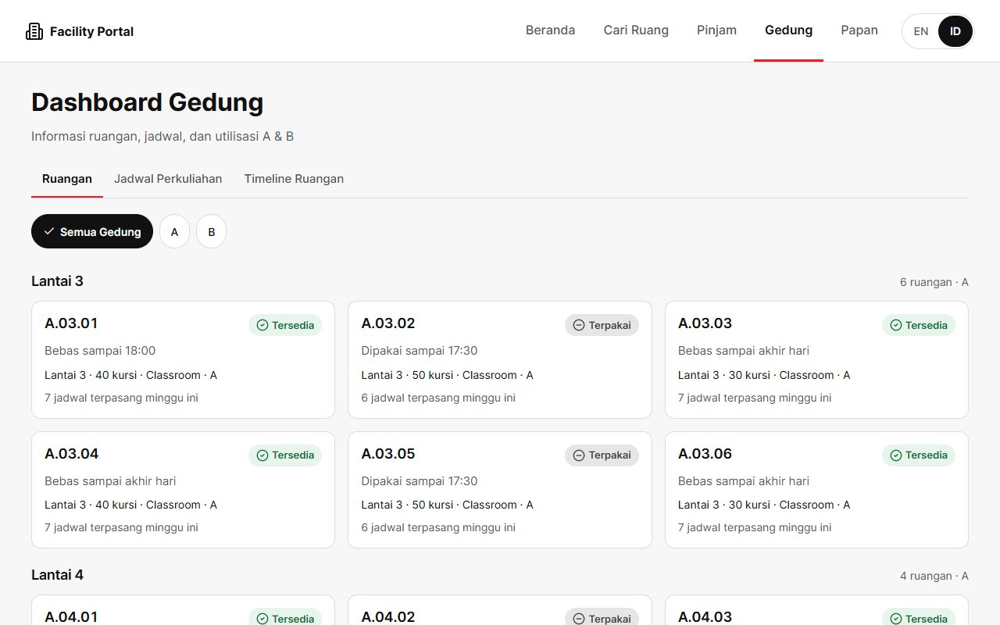 |

### On a phone

Home, rooms with what is happening now and next, and room search results:

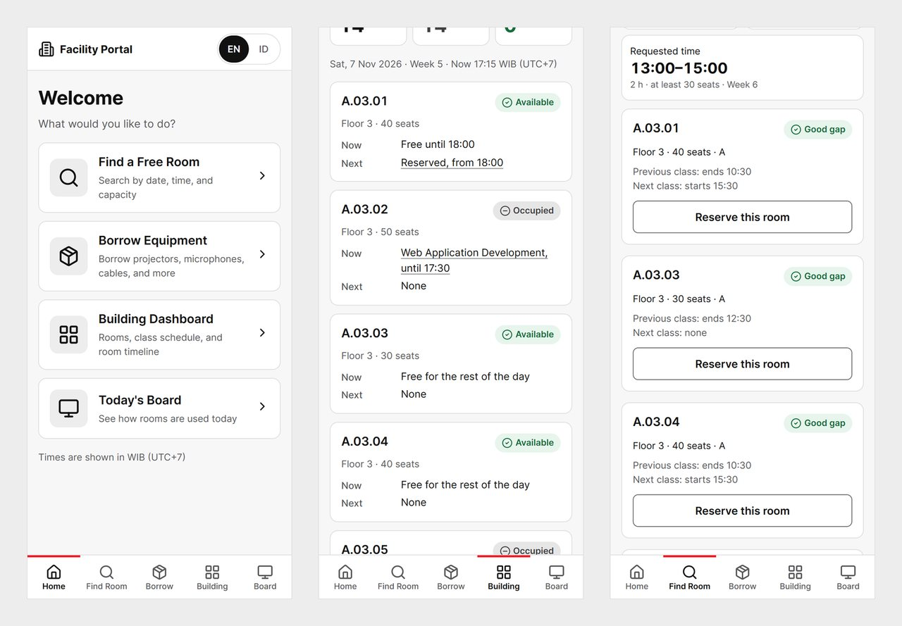

## Engineering notes

- **Privacy by default:** public pages use an allowlist of fields, so applicant names, contacts, staff IDs, request numbers, and reservation purposes never reach the browser, not even in the page source. Automated tests cover this.
- **One source of truth for room usage:** classes, reservations, replacement classes, and closures merge into one list that the timeline, the board, and room search all read.
- **Two languages without touching the logic:** a middleware picks the language, and server messages are translated in the display layer. Anything unrecognized falls back to the original text.
- **Accessible and responsive:** status is never shown by color alone, and the pages have no horizontal page scroll from 320 px upward.
- **Plain stack:** Laravel, Blade, and hand-written CSS and JavaScript, with no front-end build step.

## Run it locally

Requires PHP 8.3 or newer and Composer.

```bash
git clone https://github.com/antarezQ/class-facility-portal.git
cd class-facility-portal
composer install
cp .env.example .env
php artisan key:generate
touch database/database.sqlite
php artisan migrate --seed
php artisan serve
```

Then open http://localhost:8000.

Run the tests with:

```bash
php artisan test
```

## What is not included

The original app also has a staff panel for approving requests, managing rooms and schedules, importing data, tracking loans with photo evidence, and viewing analytics. Those parts are not in this repository, and neither is any real schedule, room, lecturer, or student data.

Since the staff panel is left out, requests sent in this version are saved but have no one to approve them.

## Credits

- [Inter](https://rsms.me/inter/) font, SIL Open Font License
- [Lucide](https://lucide.dev/) icons, ISC License

## License

© Muhammad Antarez Qhadafi. All rights reserved. The code is published for viewing as a portfolio piece.
